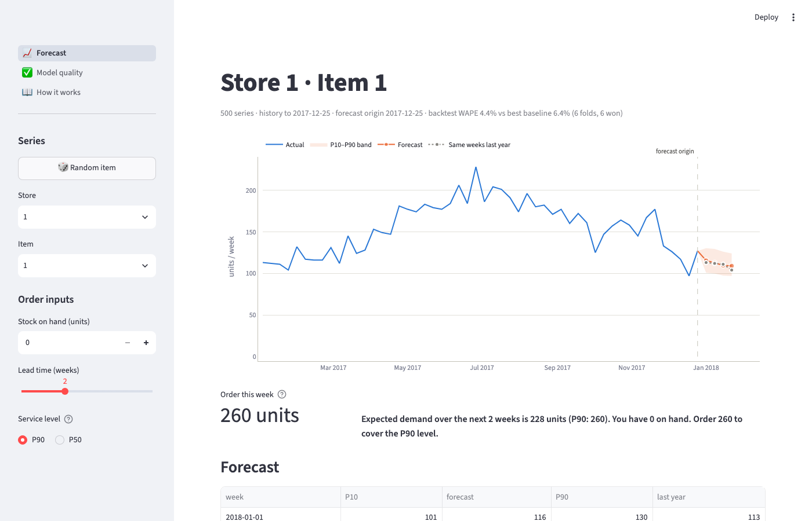
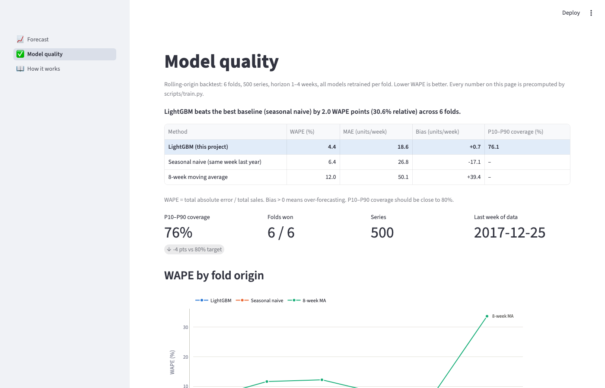
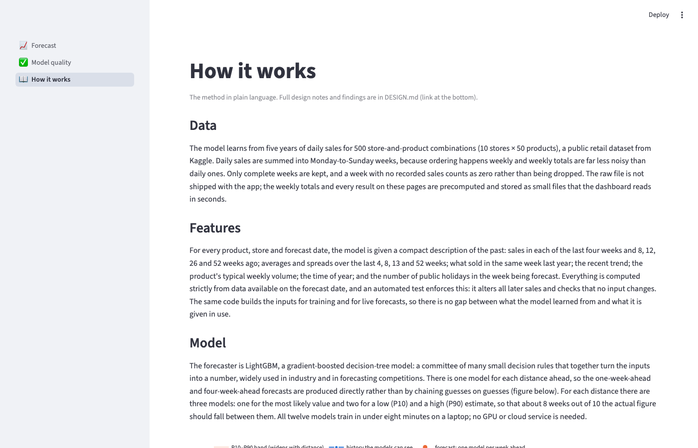

# demand-forecast

**Weekly sales forecasts per store and product, with an uncertainty band and a plain-language answer to "how much should I order this week?"**

<!-- M5:  -->

🚀 **Live demo:** `https://<app>.streamlit.app` _(URL filled in after deploy)_ · 📄 **How it works:** [docs/DESIGN.md](docs/DESIGN.md)

## The problem

Every week a retailer decides how much of each product to order. Too little and the shelf is empty; too much and cash sits in stock. Most teams guess from last week or last year. This project forecasts the next 4 weeks for every store × product, shows how sure it is, and turns that into an order quantity — and it proves, on a held-out backtest, how much better than the simple rules it is.

## What this does

- Forecasts 4 weeks ahead for 500 store–product series (public Kaggle retail data) with P10–P90 bands
- Compares against the two rules a business would use anyway (same week last year; 8-week average) in a rolling-origin backtest with leakage tests
- Dashboard: history + forecast chart, order recommendation from stock on hand, lead time and service level, model-quality page
- No LLM, no GPU: LightGBM trains in minutes on a laptop; the app reads precomputed artifacts

## Results

Rolling-origin backtest on the real data: 6 folds (origins every 4 weeks, July–November 2017), 500 store–product series, horizon 1–4 weeks, models retrained per fold. Numbers from `python scripts/eval.py`.

| Method | WAPE (backtest) |
|---|---|
| Seasonal naive (same week last year) | 6.4% |
| 8-week moving average | 11.9% |
| **LightGBM (this project)** | **4.4%** |

Improvement vs best baseline: **30.6%** · folds won: **6/6** · P10–P90 coverage: **76%** (target 80%) · bias: +0.7 units/week

Where it is weakest: the lowest-volume series. The worst 10 items sell 110–217 units a week against a median of 351, and their WAPE is 9–11%, so there is no catastrophic tail. Not in the data: promotions and prices, and the intermittent near-zero products that real catalogues have. Full findings in [docs/DESIGN.md](docs/DESIGN.md#findings-milestone-3-real-data).

## Run it yourself

```bash
git clone https://github.com/DavutKursun/demand-forecast && cd demand-forecast
python -m venv .venv && source .venv/bin/activate
pip install -r requirements-dev.txt
# macOS only: LightGBM's wheel links the OpenMP runtime, which Homebrew provides
brew install libomp

python scripts/download_data.py        # Kaggle API; or: python scripts/prepare.py --synthetic
python scripts/prepare.py              # → artifacts/weekly.parquet
python scripts/train.py                # backtest + final forecasts → artifacts/ (8 files)
python scripts/eval.py                 # prints the results table
streamlit run app.py
```

The dashboard reads only `artifacts/`, all of it committed, so it runs without a Kaggle account: `weekly.parquet`,
`forecasts.parquet`, `backtest_summary.csv`, `backtest_by_fold.csv`, `backtest_by_series.csv`, `worst_items.csv`,
`feature_importance.csv`, `metrics.json`. Nothing is trained or recomputed at page load.

Tests: `pytest` (38 tests incl. headless renders of all three pages, ~30 s). The dashboard tests also pass in a venv built from `requirements-app.txt` alone.

## Run the dashboard

```bash
streamlit run app.py      # or: make app
```

It starts in seconds and reads only the committed `artifacts/`; nothing is trained at runtime.

**Forecast.** Pick a store and product (or hit *Random item*). The chart shows the last 52 weeks of
sales, the 4-week forecast with its P10–P90 band, the same weeks last year as a dotted line, and the
forecast origin. Enter stock on hand, lead time and service level in the sidebar and the page tells you
how much to order and spells out the arithmetic. The forecast table and CSV downloads (this series or
all 500) sit below the chart, with the series' own backtest WAPE for context.

**Model quality.** The backtest table with the LightGBM row highlighted and a one-line verdict; WAPE by
fold origin for the model and both baselines; coverage, folds won, series count and data end; the
distribution of per-series WAPE with its median; the ten hardest series with a note on why; the top-15
features by gain; and a plain-language paragraph for a store manager.

**How it works.** Four short sections, Data, Features, Model, Backtest & recommendation, written for a
client who is not a data scientist, a figure explaining the direct multi-horizon design, a "what this is
not" list, and a link to the design notes.

## Screenshots

**Forecast** — history, 4-week forecast with P10–P90 band, last year's same weeks, order recommendation



**Model quality** — backtest table with verdict, headline metrics, WAPE by fold



**How it works** — the method in plain language



Captured headless at 1400×900 with `python scripts/screenshots.py` (Playwright).

## Deploy your own

Streamlit Community Cloud installs from `requirements.txt`, which here just includes
`requirements-app.txt`: the dashboard's slim runtime set (streamlit, plotly, pandas, numpy, pyarrow,
jinja2), no LightGBM. Training dependencies live in `requirements-dev.txt`.

1. Fork this repository.
2. On [share.streamlit.io](https://share.streamlit.io) click **Create app**, pick the fork and branch `main`.
3. Set **Main file path** to `app.py`; under **Advanced settings** choose **Python 3.11** (the version the
   pins were tested with; Community Cloud reads no version file). Deploy. The committed `artifacts/`
   are all the app needs, so there is no Kaggle step.

`.streamlit/config.toml` sets the light theme, headless mode and disables usage stats.

## Stack

Python · pandas · LightGBM · scikit-learn · Streamlit · Plotly · pytest · GitHub Actions

## License

MIT
